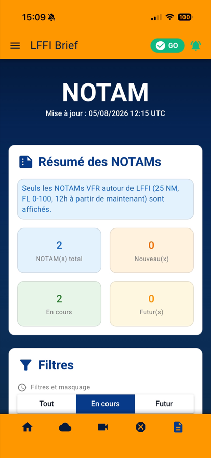
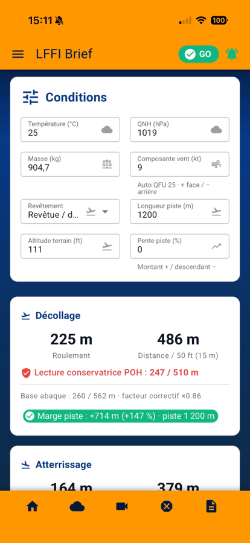
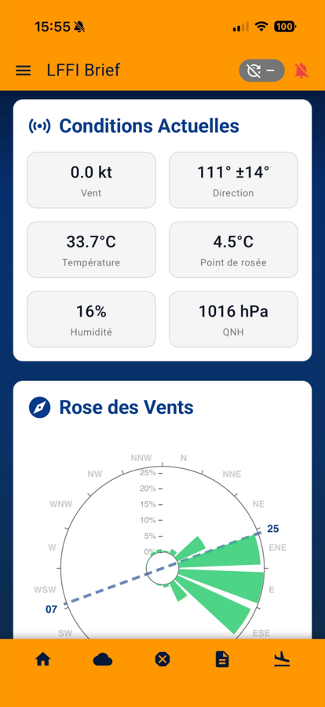
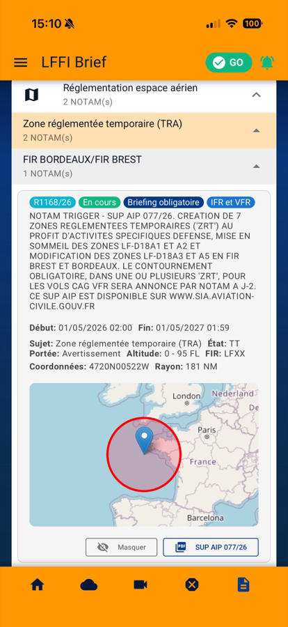
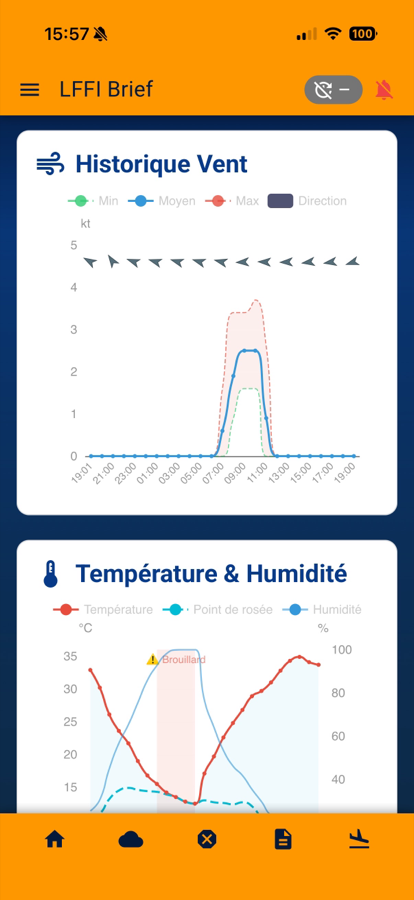
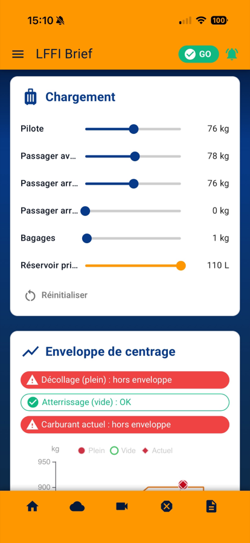
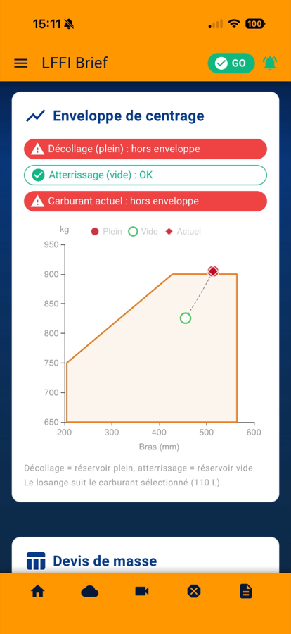

# Airfield Brief

[](LICENSE)
[](https://github.com/stephanfo/airfield-brief/actions/workflows/ci.yml)

**Application web progressive (PWA) de briefing pré-vol VFR pour un aérodrome.** Elle rassemble sur un seul écran ce qu'un pilote privé consulte avant de partir : météo décodée, NOTAMs filtrés, zones AZBA actives, cartes TEMSI/WINTEM/VAC, éphémérides (nuit aéronautique), et — si le club en dispose — station météo locale et webcam terrain.

Le projet est né pour l'aérodrome d'**Ancenis (LFFI)** et est **conçu pour être repris par n'importe quel aérodrome** : l'identité du terrain tient dans un seul fichier de configuration (voir [Adapter à votre aérodrome](#adapter-à-votre-aérodrome)).

> ⚠️ **Aide à la préparation, pas source officielle.** Les données proviennent de sources officielles (SIA, Météo-France) mais sont retraitées et mises en cache. Le briefing réglementaire reste celui des services officiels ; la responsabilité de la décision de vol appartient au commandant de bord.

**Démo** : <https://brief.aeroclub-ancenis.fr>

---

## Fonctionnalités

| Module                 | Description                                                                              | Optionnel |
| ---------------------- | ---------------------------------------------------------------------------------------- | :-------: |
| **Météo**              | METAR/TAF décodés en français (~900 traductions de Q-codes), seuils VFR personnalisables |           |
| **Go/No-Go VFR**       | Bilan synthétique des critères (visibilité, plafond, vent, traversier)                   |           |
| **NOTAM**              | Filtrage multi-critères : validité, trafic VFR/IFR, niveaux de vol, catégories           |           |
| **AZBA**               | Statut des zones militaires avec créneaux d'activation                                   |           |
| **TEMSI / WINTEM**     | Cartes météo significatives et vents en altitude                                         |           |
| **VAC**                | Cartes d'approche, triées par distance au terrain                                        |           |
| **Éphémérides**        | Aube/crépuscule et **nuit aéronautique** (calcul IMCCE)                                  |           |
| **Station locale**     | Vent instantané, historique, rose des vents, atmosphère                                  |     ✔     |
| **Stress thermique**   | Risque chaleur pilote (grille Commission Prévention Sécurité FFA)                        |     ✔     |
| **Webcam**             | Vue du terrain + timelapse                                                               |     ✔     |
| **Préparation vol**    | Masse & centrage, performances décollage/atterrissage, carburant, check-lists, tarif     |     ✔     |
| **REX sécurité**       | Retours d'expérience FFA + synthèse mensuelle, soumission d'un REX au CPS                |     ✔     |
| **Notifications push** | Alertes NOTAM et AZBA (Firebase Cloud Messaging)                                         |     ✔     |
| **Mode hors ligne**    | Service Worker Workbox — le dernier briefing reste consultable sans réseau               |           |

Les modules marqués ✔ se désactivent en une ligne de configuration s'ils ne s'appliquent pas à votre terrain.

---

## Aperçu

<table>
  <tr>
    <td width="25%" align="center">
      
      <br /><sub><b>Synthèse</b> — verdict GO, piste en service, conditions</sub>
    </td>
    <td width="25%" align="center">
      
      <br /><sub><b>NOTAM</b> — ce qui change autour du terrain</sub>
    </td>
    <td width="25%" align="center">
      
      <br /><sub><b>Performances</b> — distances et marge piste</sub>
    </td>
    <td width="25%" align="center">
      
      <br /><sub><b>Station locale</b> — rose des vents et axe de piste</sub>
    </td>
  </tr>
</table>

<details>
<summary><b>Plus de captures</b> — filtrage et décodage des NOTAMs, masse &amp; centrage, historique de la station</summary>
<br />

<table>
  <tr>
    <td width="33%" align="center">
      
      <br /><sub>Filtres : validité, trafic, niveaux de vol, masquage</sub>
    </td>
    <td width="33%" align="center">
      
      <br /><sub>NOTAM décodé, situé sur une carte</sub>
    </td>
    <td width="33%" align="center">
      
      <br /><sub>Historique 24 h, brouillard signalé</sub>
    </td>
  </tr>
  <tr>
    <td align="center">
      
      <br /><sub>Chargement ajusté au curseur</sub>
    </td>
    <td align="center">
      
      <br /><sub>Enveloppe de centrage <i>(ici un cas hors limites)</i></sub>
    </td>
    <td align="center">
      
      <br /><sub>Devis de masse détaillé</sub>
    </td>
  </tr>
</table>

</details>

---

## Comment ça marche

L'application **n'a pas de backend**. Elle lit des fichiers JSON statiques, produits séparément et déposés sur l'hébergement :

```
Sources officielles          Pipeline (hors dépôt)        Cette PWA
SIA, Météo-France,     →     N8N / scripts PHP      →     public/data/*.json
IMCCE, Open-Meteo,           (cron, ~1×/heure)             ↓
station locale, FFA                                  Pinia → useDataFetcher → useCache
                                                     (cache TTL + stale-while-revalidate)
```

Cette architecture rend l'application entièrement statique : aucun serveur applicatif, un hébergement mutualisé suffit.

> **À savoir avant de forker** : le pipeline de données (workflows N8N, scripts d'agrégation) **n'est pas encore public**. Le dépôt fournit le format attendu de chaque fichier ([ARCHITECTURE.md](docs/ARCHITECTURE.md)) et des exemples exploitables, mais vous devrez alimenter `public/data/` par vos propres moyens. L'ouverture de ces services est prévue (voir [ROADMAP.md](docs/ROADMAP.md)).

---

## Démarrage rapide

```bash
git clone https://github.com/stephanfo/airfield-brief.git
cd airfield-brief
npm install
npm run data:example   # installe des données d'exemple (sans backend)
npm run dev            # → http://localhost:9000
```

`npm run data:example` n'écrase jamais un fichier existant : la commande est sans risque sur une installation qui reçoit de vraies données.

### Commandes

```bash
npm run dev            # serveur de développement (rechargement à chaud)
npm test               # tests unitaires (Vitest)
npm run test:watch     # tests en mode watch
npm run test:cov       # couverture
npm run lint           # ESLint
npm run format         # Prettier
npm run build          # build SPA
npx quasar build -m pwa  # build PWA (le mode de déploiement)
```

---

## Adapter à votre aérodrome

Deux endroits, et deux seulement.

### 1. L'identité du club — `src/config/club.config.js`

C'est **le** fichier à éditer. Il porte le nom de l'application, les caractéristiques du terrain, les URLs de webcam, les topics de notification, les zones AZBA à surveiller en priorité, et les modules activés :

```js
export const CLUB_CONFIG = {
  app: { name: 'Mon Brief', shortName: 'Brief', description: '…' },
  airfield: {
    icao: 'LFXX',
    name: 'Mon Terrain',
    lat: 47.408,
    lon: -1.177,
    elevationFt: 111,
    elevationM: 34,
    runwayHeading: 250, // les QFU en sont dérivés
    runwayLengthM: 1200,
    runwayLengths: { 25: 1200, '07': 1200 }, // si les seuils diffèrent
    surface: 'paved', // paved | grass | wetGrass
  },
  webcam: null, // null = pas de webcam
  azba: { priorityZones: ['R149E'] },
  notificationTopics: [
    /* … alignés avec votre émetteur */
  ],
  features: {
    // les modules dont vous ne disposez pas
    webcam: false,
    station: false,
    thermal: true,
    rex: false,
    aircraft: true,
    notifications: false,
  },
  storagePrefix: 'brief', // préfixe des clés localStorage
}
```

Un module désactivé disparaît complètement : sa route, son entrée de menu et son chargement de données. Pas de page en erreur.

### 2. Le déploiement — `.env`

```bash
cp .env.example .env
```

| Variable       | Rôle                                                               |
| -------------- | ------------------------------------------------------------------ |
| `PUBLIC_PATH`  | `/` à la racine du domaine, `/sous-chemin/` sinon                  |
| `APP_URL`      | URL absolue du site (image d'aperçu pour les partages)             |
| `FIREBASE_*`   | Notifications push — inutiles si `features.notifications` est faux |
| `REX_SUBMIT_*` | Service de soumission de REX — inutiles si `features.rex` est faux |

**Les icônes** (`public/icons/`) sont génériques (avion, météo, piste) et réutilisables telles quelles. Pour les vôtres : remplacez `app-icon.png` à la racine (512×512 minimum) puis lancez `npx icongenie generate -m pwa -i app-icon.png`. Les écrans de démarrage iOS ne sont pas activés (l'application s'ouvre sur la couleur du thème) ; les générer suppose d'ajouter les `metaVariables` `appleLaunch*` dans `quasar.config.js`.

Le détail de l'architecture de configuration est dans l'[ADR-030](docs/DECISIONS.md), et la mise en production dans [DEPLOYMENT.md](docs/DEPLOYMENT.md).

---

## Stack technique

| Catégorie       | Technologies                                                  |
| --------------- | ------------------------------------------------------------- |
| Cœur            | Vue 3.5 (Composition API), Quasar 2.16, Pinia 3, Vue Router 4 |
| Cartographie    | Leaflet 1.9                                                   |
| Graphiques      | ECharts 6 (vue-echarts)                                       |
| Notifications   | Firebase 12 (FCM)                                             |
| PWA             | Workbox 7                                                     |
| Build / qualité | Vite (@quasar/app-vite), ESLint 9, Prettier 3, Vitest         |

---

## Documentation

| Fichier                                     | Description                                      |
| ------------------------------------------- | ------------------------------------------------ |
| [INDEX.md](docs/INDEX.md)                   | Point d'entrée, parcours de lecture par profil   |
| [ARCHITECTURE.md](docs/ARCHITECTURE.md)     | Stores, composables, cache, **schémas des JSON** |
| [DECISIONS.md](docs/DECISIONS.md)           | Architecture Decision Records — le _pourquoi_    |
| [DEPLOYMENT.md](docs/DEPLOYMENT.md)         | Mise en production, `.htaccess`, checklist       |
| [UI_CHARTER.md](docs/UI_CHARTER.md)         | Règles d'interface                               |
| [NOTIFICATIONS.md](docs/NOTIFICATIONS.md)   | Configuration Firebase / FCM                     |
| [ROADMAP.md](docs/ROADMAP.md)               | Ce qui est prévu                                 |
| [ai/AGENT_GUIDE.md](docs/ai/AGENT_GUIDE.md) | Guide technique (contrats, patterns, pièges)     |

Contributions bienvenues — voir [CONTRIBUTING.md](CONTRIBUTING.md).

---

## Licence

[GNU AGPL v3](LICENSE) — Copyright (C) 2026 Stephanfo.

Vous pouvez utiliser, modifier et redistribuer ce logiciel. La clause « Affero » implique que **si vous déployez une version modifiée sur un serveur accessible au public, vous devez en publier le code source**. C'est délibéré : les améliorations apportées par un aéroclub profitent aux autres.

## Contact

Par les [issues GitHub](https://github.com/stephanfo/airfield-brief/issues) — questions, bugs et retours d'utilisation d'autres aérodromes sont les bienvenus.
